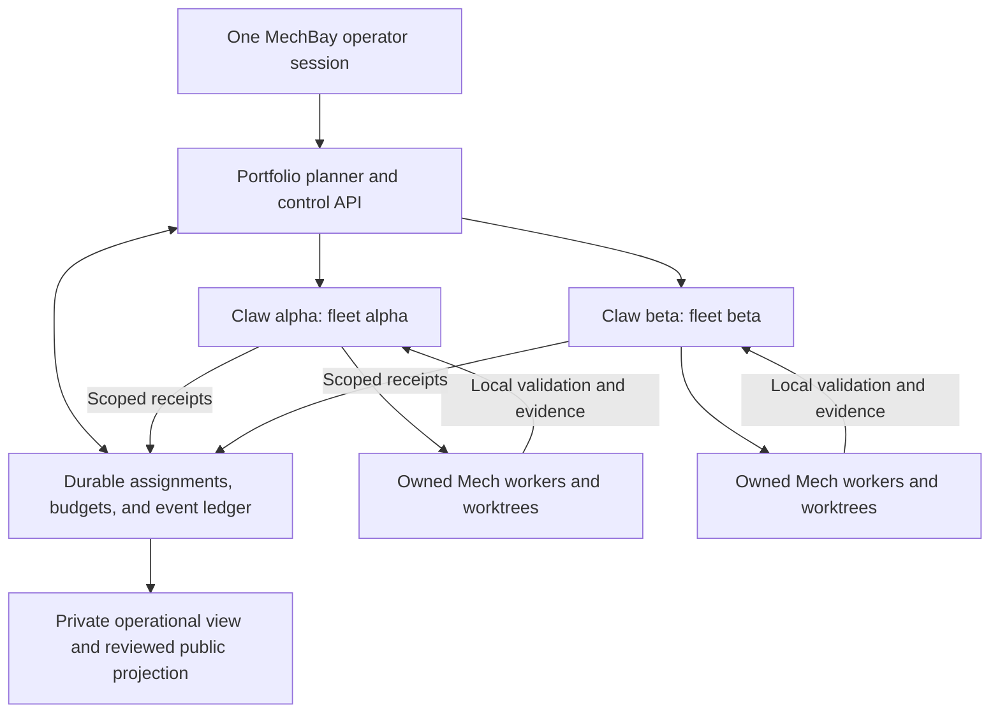

# Coordinating remote Claw fleets from one MechBay session

Research date: 2026-10-26. Status: proposed architecture and delivery plan.
This document does not enable a remote service or authorize live dispatch.

## Recommendation

Build MechBay as a durable coordinator for a portfolio of work. Each remote Claw
owns execution within its declared fleet; each Mech supplies domain acceptance
criteria. One MechBay session should show what matters, what can run next, who
owns it, and what evidence establishes completion. The durable state must survive
that session ending.

The objective is **verified progress on the highest-value work**. Prefer shared
improvements that unlock useful downstream work, with explicit confidence and
cost estimates. Agent activity, completed cycles, and PR counts are supporting
telemetry. They do not establish scientific or user value.

The first useful release is a narrow end-to-end coordination slice: discover two
independent Claws, distinguish their fleets, admit one bounded task through its
owner, survive a lost acknowledgement and coordinator restart, and verify its
result. Prove this with synthetic adapters before one authorized remote canary.

## Evidence and scope

| Component | Reviewed baseline | Evidence boundary |
|---|---|---|
| XMechBay | `2592ba00aaec21637169696bdf7303ed77c307ce` | All 37 tracked files and the complete fresh worktree inventory, including hidden and ignored files; Git internals excluded from the worktree comparison |
| CultureBotAI Claw | `432f4ecffa33fef3d3e4543bcd9bd3c00131408c` | Pinned public checkout, relevant modules, tests, guides, and selected issue/PR dependencies; Git-tree and ignored-file-inclusive absence searches |
| Upstream protocols | Official documentation retrieved 2026-10-26 | Design inputs; compatibility with an installed runtime has not been established |

This is an architecture assessment of MechBay and Claw. It does not establish
coverage of every Mech backlog, deployed machine, provider, or operating system.
No live agent received input, no private configuration was inspected, and no paid
execution or remote fleet was launched.

Here, **Claw** means the CultureBotAI orchestration repository. **OpenClaw
Gateway** means the separate upstream runtime. Claw's README explicitly says that
the external runtime is not a package dependency while its general execution
integration is disabled. A Gateway's documented features are therefore not proof
that this Claw checkout exposes them. [C1]

### What is already available

| Foundation | Reuse | Limit for this goal |
|---|---|---|
| MechBay terminal controller | Explicit host selection, exact configured tmux-session matching, one-pane checks, prompt guards, single-input overrides | Local window/pane selectors do not identify a durable Claw assignment or repository generation. [M1] |
| MechBay session inspector | Process/pane inventory; optional screen classification; unknown and probe-error reporting | One host per invocation; no fleet aggregation, freshness envelope, task receipt, or capacity model. [M2] |
| Claw fleet configuration | Validated manifest selection through `KG_MICROBE_FLEET_MANIFEST` or an explicit path; repository settings accept a manifest and validate worktree/origin identity | Independent fleet configuration already exists. Registration, immutable fleet snapshots, and cross-instance ownership still need a federation contract. [C2], [C2a] |
| Claw locks and boss workflow | Token-owned local file leases; separate task branches and worktrees | Leases coordinate one machine and short metadata operations. Boss dispatch is a local workflow, not a remote task service. [C3], [C3a] |
| Claw supervisor | Durable reserve-before-send intent, stable action IDs, and suppression of repeated uncertain delivery | Current session adapters depend on local process/native-session/Terminal facilities. Reuse the ledger pattern and supported adapters without broadening their authority. [C4], [C4a], [C4b] |
| Claw workflow evidence | Pinned effective profiles, hashed artifacts, ordered stages, verified closure, and canonical shared-artifact authority | Cross-Claw task routing and portfolio outcomes must preserve these semantics. A syntactically valid artifact still requires domain acceptance. [C5] |
| Claw progress projection | Append-only closure evidence, observation ages, partial-coverage reporting, and a restricted public projection | Collection accepts multiple local runtime directories under one manifest. Run identity hashes only `run_id`, without a Claw namespace, and publication targets one destination fixed in code. Federation needs producer namespaces and replay-safe ingestion. [C6], [C6a], [C6b], [C6c] |
| Execution and resource policy | Validated CLI dry runs; explicit provider-use authorization and relative cost tiers | General `agent run`/`pipeline run` live execution is refused. Relative cost tiers are not a shared monetary/token budget. Supported local supervision is a separate surface. [C1], [C7] |

## Gaps that determine the design

P1 denotes a material enabling or reliability gap; P2 denotes a subsequent
improvement. These are report priorities, not new GitHub labels or issue states.

| ID | Gap and consequence | Priority | Observable acceptance criterion |
|---|---|---|---|
| G1 | No MechBay registry of Claw identity, fleet membership, manifest revision, and capabilities; equal local names can collide | P1 | Two Claws with the same Mech basename, PID, pane, and run ID remain distinct. An undeclared repository or changed repository identity is refused. |
| G2 | No versioned remote Claw task interface; terminal delivery cannot establish task acceptance | P1 | Discovery, observation, admission, reconciliation, and cancellation have versioned schemas. A Claw refuses unsupported operations and out-of-fleet targets. |
| G3 | No federation task ledger or end-to-end idempotency contract; a lost acknowledgement can cause duplicate work | P1 | Duplicate request IDs return the original durable receipt; the same ID with changed content is rejected. Crashes around launch yield reconciled or explicitly uncertain state. |
| G4 | Local locks do not establish cross-Claw ownership; an old controller may remain active after a partition | P1 | Exclusive assignments have generations enforced at protected effect boundaries. Expiry alone never licenses blind redispatch of uncertain work. |
| G5 | No cross-Claw source-labelled aggregate with observation age, coverage, and partial failures | P1 | One unreachable Claw does not block other observations; its last observation becomes stale. Out-of-order messages cannot overwrite newer state. |
| G6 | Progress and artifact exchange lack a federation producer namespace | P1 | Evidence is keyed by producer, task, attempt, and artifact digest. Results with a wrong pin, digest, owner, or regressing sequence are rejected. |
| G7 | No shared dependency frontier, resource reservations, or review-capacity admission | P1 before concurrent dispatch | Two Claws cannot oversubscribe a shared quota pool or reviewer allocation. A shared change releases before its consumers start; conflicting writes serialize. |
| G8 | No outcome-based portfolio policy | P2 after trustworthy task/evidence data | Ready work is ranked transparently by expected verified benefit and unblocking value, with confidence, separate resource constraints, and recorded selection reasons. |
| G9 | Terminal SSH commands and SCP transfers have no execution deadline | P1 reliability defect | A stalled operation is bounded; potentially delivered input is reported as uncertain and reconciled before retry. A slow Claw cannot freeze the portfolio view. [M1] |
| G10 | Screen classification can treat historical prompt text as a current block | P2 observation limitation | Scheduling uses authoritative task state plus freshness; screen warnings remain separate. Conservative input guards are preserved. [M1], [M2] |

G1–G8 are capability gaps or missing cross-instance guarantees, not claims of
demonstrated damage to current runs. G9 is visible in `Transport.run` and the SCP
call: neither supplies a subprocess execution timeout. SSH's connection timeout
does not cover a command that stalls after connecting.

G10 was reproduced offline with an earlier approval message followed by a current
`Pursuing goal` footer; the classifier returned `APPROVAL`. This is consistent
with its documented conservative heuristic. It is a reason to distinguish
evidence sources, not to weaken guards before terminal input.

Reproduce the observations without contacting a host:

```bash
python3 -B scripts/adhoc/probe_coordination_assumptions.py --repo-root .
```

The [saved synthetic result](federation-probe-2026-10-26.json) reports the two
missing execution deadlines and the classifier result. It contains no raw screen
or private deployment data.

## Proposed responsibility model



| Owner | Authority |
|---|---|
| MechBay | Portfolio priorities, task dependencies, assignment ownership, global admission limits, aggregate status, and proposed federation schemas |
| Each Claw | Its pinned fleet manifest, local repository checks, executor admission, child workers, worktrees, local locks, local policy, and task/evidence receipts |
| Each Mech | Its data, domain validation, applicability rules, scientific review, and acceptance criteria |
| Human/operator | Outcome weights and authorization boundaries, approvals that cannot be delegated, sign-in, and consequential review/publication decisions |
| Reporting interface | Read-only views of approved projections |

MechBay sends scoped tasks to the owning Claw. It does not inherit permission to
type into that Claw's child worker panes. The current [control contract](../fleet-control-contract.md)
remains the ownership boundary. A single operator session is one interface to
persistent coordination; chat history is not the assignment database.

### Identity and configuration

Register an opaque `claw_id`, `fleet_id`, deployment generation, protocol range,
manifest digest, supported executors, and capabilities. Keep network addresses,
private root mappings, credential references, and operational evidence in ignored
deployment configuration. Each Claw advertises a validated manifest snapshot;
MechBay does not infer membership from which repositories happen to be reachable.

Identify repositories by forge plus immutable repository ID and retain the
canonical name for display. Replacing a repository under the same name must
invalidate the old assignment. Use `(claw_id, fleet_id, repository_id)` for
execution routing and `(forge, repository_id, ref/write_scope)` for shared
conflict detection. Initially require disjoint write ownership across fleets.
Overlapping read-only access is a separate capability.

A synthetic registry can contain `claw-alpha` at `alpha.example.invalid` and
`claw-beta` at `beta.example.invalid`, both displaying a local Mech key
`sample-project`, but bound to different immutable repository identities. No
personal path or production inventory is needed to test the design.

### Task, evidence, and authority envelopes

The proposed task packet carries:

- `task_id`, `attempt_id`, idempotency key, and canonical request-content digest;
- theme/outcome ID, acceptance checks, baseline evidence, and expected benefit;
- owning Claw/fleet, manifest digest, repository ID, base revision, workflow pin,
  executor capability, and expected write set;
- dependencies on verified artifacts or released canonical revisions, not merely
  on another worker stopping or opening a PR;
- ownership generation, authorization scope/expiry, resource reservations, and
  human-review requirements.

Define canonical serialization before hashing requests. Exclude transport-only
fields from the identity digest. Bind receipts to the complete reviewed scope;
a changed task body under an existing key must fail instead of silently replacing
the original work.

The minimum adapter methods are proposed `describe`, `observe`, `admit`, `submit`,
`get_task`, `cancel`, and `get_artifact`. These names are a design sketch, not
commands shipped by this repository. An initial SSH/stdin JSON adapter can avoid
opening a new inbound service, but still needs strict schemas, authenticated
endpoint identity, bounded output, deadlines, and local authorization. Do not
turn the task body into an arbitrary shell command. Local Claw checks remain
authoritative even when the central planner has approved a plan.

Keep distinct fields for task lifecycle, delivery certainty, observation health,
and blockers. For example, `running` can coexist with stale observation; a task
can be `accepted` without having started. `cancel_requested` becomes `cancelled`
only after a worker-exit or defined checkpoint receipt. A result becomes verified
only after pinned acceptance checks and any required review. Authentication
requests remain user decisions.

### Persistence, partitions, and fencing

Start with one coordinator writer and a local transactional store on its service
host, plus a durable outbox/inbox and append-only events. A single-host SQLite
implementation is a candidate; it is not a shared network-file lock service.
Each Claw also needs a durable admission/task journal. Keep the store interface
replaceable if multi-controller availability later justifies a server database
or workflow engine.

Persist intent before sending and admission before acknowledging. Reconciliation
must cover the crash between recording acceptance and launching a worker, as well
as the crash after launch but before recording its handle. A stable task-aware
executor must identify an existing attempt. A terminal send by itself cannot
provide that guarantee. Preserve Claw's existing uncertain-delivery semantics.

Use renewable assignment leases and monotonic ownership generations. Heartbeats
are evidence of recent contact, not proof of useful progress. All protected shared
effects must check the current generation: shared-checkout writes, accepting an
artifact as authoritative, and publishing repository changes. Isolated computation
may continue only within its previously granted scope and limits.

A central lease record alone cannot fence an old worker that writes directly to
a repository. Route protected publication through an enforcing adapter and retain
expected-base-revision checks. An incompatible legacy executor is observe-only
for federation, or requires explicit manual recovery with no automatic handoff.
Loss of contact means uncertain ownership until reconciliation or a demonstrated
revocation boundary; it does not justify launching a duplicate elsewhere.

## Selecting the highest-value work

Use a two-step decision: establish eligibility, then compare expected outcomes.

1. Preserve consequence priority: demonstrated correctness failures and committed
   deliverable blockers retain their importance while blocked.
2. Build themes with one canonical owner and one disposition per full issue
   identity. Verify current code and open PRs before scheduling; an open issue
   is not proof that work remains.
3. Admit only the ready dependency frontier: evidence available, applicable
   capability, satisfied prerequisites, current ownership, authorization,
   resource headroom, and review capacity.
4. Compare eligible themes by expected verified benefit, downstream unblocking
   value, confidence, and scarce-resource demand. Record ranges and reasons.
   Keep money, tokens, compute time, API quotas, and reviewer time as separate
   constraints; an unexplained combined score would hide tradeoffs.
5. Use bounded diagnostic tasks where uncertainty prevents a decision. Add aging
   or an explicit exploration allocation to avoid permanent starvation, while
   preserving critical dependency order.

A shared validation repair may rank above several cosmetic tasks because its
verified release enables multiple consumers. Count the shared fix once; count
consumer adoption only after each consumer passes its acceptance checks. A
high-value blocked theme remains visible while a ready independent task proceeds.

Budget reservations must be atomic across tasks sharing a provider/quota pool,
even when those tasks run on different hosts. Replayed requests cannot reserve or
charge twice. Record estimates separately from measured consumption; unknown usage
remains unknown. Hard monetary guarantees require a backend that can enforce them.
Otherwise bound concurrency, duration, and retries, reserve headroom, and stop new
admission when reliable accounting is unavailable. Child workers inherit the
parent's limits. A global pause first stops new admission and then requests
acknowledged local pauses; it is not a shared-server kill command.

| Outcome measure | Evidence needed |
|---|---|
| Correctness or coverage improvement | Baseline and result against an explicit applicable denominator, with domain review |
| Downstream usefulness | Released artifact consumed successfully by the intended downstream system |
| Reproducibility | Input, schema and code pins, artifact digests, and repeatable checks |
| Delivery efficiency | Ready-to-verified-delivery time, blocked age, resource use, and reviewer effort |
| Quality after delivery | Reopened defects, review corrections, and remaining uncertainty |
| Coordination reliability | Duplicate starts, ownership conflicts, uncertain deliveries, stale observations, and recovery time |

## Existing work to integrate rather than duplicate

These states were checked on 2026-10-26; refresh them before implementation.

| Work | Verified state | Planning consequence |
|---|---|---|
| Claw [PR #648](https://github.com/CultureBotAI/culturebotai-claw/pull/648), head `9010d0f091ef24d2226a870eba369a6fca622f5a` | Open; immutable instruction delivery and native acceptance/progress follow-ups | Review and integrate the applicable acceptance semantics before building a remote wrapper. Do not count them as current main behavior. |
| Claw [PR #669](https://github.com/CultureBotAI/culturebotai-claw/pull/669), head `c92ec930ce68259c659c67d42bccdc665d5c5be7` | Open; ownership links, process-exclusion regression coverage, and boss collision preflight | Preserve the execution boundary and incorporate reviewed preflight behavior. This PR does not add a remote task service. |
| Claw [PR #537](https://github.com/CultureBotAI/culturebotai-claw/pull/537) and [PR #543](https://github.com/CultureBotAI/culturebotai-claw/pull/543) | Open; exporter work is stacked on graph-shape work; #537 currently has merge conflicts | A concrete example of a canonical dependency before consumer rollout; resolve and review the canonical change before scheduling dependent adoption. |
| Claw [issue #643](https://github.com/CultureBotAI/culturebotai-claw/issues/643) | Open, but its requested redraw guard is present on pinned main | Backlog ingestion needs evidence-based disposition before work is scheduled. [C8] |

Merge decisions remain separate. No upstream PR was merged or changed during
this research. Deployment rollouts must pin the reviewed resulting revisions.

## Technology choices

| Option | Useful contribution | Decision for the first release |
|---|---|---|
| Existing SSH and guarded terminal tools | Reachability, observation, and explicitly authorized maintenance | Retain as diagnostics and as a transport option for a typed Claw adapter; add operation deadlines. Terminal delivery alone is not task acceptance. |
| OpenClaw Gateway | Upstream documents scoped WebSocket methods and remote connection patterns; isolated Gateway profiles have separate state/config/ports | Evaluate only if an actual selected Claw runtime exposes a compatible API. Separate Gateways do not supply this portfolio scheduler automatically. [E1], [E2] |
| MCP | A standard way to expose schema-described tools to an operator session | A possible MechBay client surface over the coordinator. Task state and authority remain in the service. Pin and test client/server protocol versions. [E3] |
| A2A 1.0 | Task identities, lifecycle, artifacts, and cancellation offer a useful interoperability mapping | Consider an adapter after the internal contract is proven; it does not decide fleet ownership, domain acceptance, or budget policy. [E4] |
| Temporal | Durable execution patterns and retry management | Defer introducing another runtime until recovery/scale requirements justify it. Application idempotency remains necessary even with a durable engine. [E5] |
| Kubernetes-style leases | A reference for explicit heartbeat and leader records | Borrow the concept without requiring Kubernetes. Application effects still need fencing and scoped authorization. [E6] |
| GitHub event ingestion | Changes to issues, PRs, checks, and merges can refresh the ready frontier | Begin with bounded polling; later deduplicate webhook deliveries and retain reconciliation for missed events. Keep public summaries separate from raw payloads. [E7] |

These are design recommendations derived from the inspected code and official
sources, not claims of installed capability. No third-party service is required
by this research change.

## Delivery waves and work packets

The proposed paths below describe future write sets; those modules do not yet
exist in MechBay. Authority for the federation wire contract belongs in MechBay;
Claw remains the authority for its fleet/workflow/domain contracts.

| Packet | Owner and likely write set | Prerequisites | Deliverable and exit condition |
|---|---|---|---|
| F0: freeze boundaries | MechBay `docs/`, proposed `schemas/federation/`; Claw adapter contract | Research review and executor selection | Versioned identities, manifests, task/receipt semantics, authority scopes, compatibility rules, and a fault-test plan agreed by both sides |
| F1: read-only portfolio view | MechBay proposed `src/mechbay/registry.py`, `observe.py`; Claw read-only adapter | F0 | Two synthetic Claws with distinct fleets and colliding local names; freshness, capability mismatch, and one unreachable endpoint handled without blocking the other |
| F2: bounded transport | MechBay terminal helpers and adapter transport | Independent of F1 after deadline semantics are agreed | Stalled SSH/SCP, cleanup failure, and post-send timeout tests; uncertain delivery never triggers blind replay |
| F3: durable ownership | MechBay proposed `ledger.py`, `ownership.py`; Claw durable admission journal | F0 | Duplicate/conflicting requests, competing controllers, stale epochs, and restart recovery tested; local Claw locks retained |
| F4: one verified dispatch | Claw executor facade; MechBay proposed `dispatch.py`, `evidence.py` | F1–F3 and a supported executor with reviewed upstream fixes | One task admitted under explicit resource bounds; lost acknowledgement reconciled; artifact hash/pin/acceptance verified; cancellation acknowledged |
| F5: ready-frontier scheduling | MechBay proposed `planner.py`, `budgets.py`; Claw usage/capacity receipts | F4 and stable accounting semantics | Capacity-limited fixtures prove selection under an explicit benefit/confidence/unblocking policy, preserve blocked high-priority work, and avoid double-counting shared-theme benefit. Dependency, conflict, quota, review-capacity, fairness, and pause/drain tests also pass; shared release precedes consumer rollout. |
| F6: measured impact and projections | MechBay outcome model and aggregate views; Claw namespaced progress exporter | F4 evidence, then F5 | Outcome baselines, adoption, actual usage and uncertainty displayed together; public export contains only allowlisted fields |

F1, F2, and the F3 store implementation can proceed in parallel once F0's shared
schemas are stable. F4 integrates them and owns the protocol test suite. F5 and
F6 can then evolve in parallel with one owner for shared event/schema changes.
Worktree separation does not remove logical conflicts: serialize overlapping
schema, generated-output, and canonical-artifact changes. Claw's supervisor,
terminal adapter, progress model, and their pending PRs need coordinated owners.

Relative effort estimates are F2 small; F0, F1, and F6 medium; F3, F4, and F5
large because they cross persistence, authority, and failure-recovery boundaries.
These are planning estimates, not delivery-time promises. Confidence is high in
the source-level gaps and existing foundations, medium in the proposed adapter
shape, and uncalibrated for outcome-value estimates until a measured pilot.

### First-release proof

Use two synthetic Claws with one Mech each and concurrency initially capped at
one. Prove discovery, source-labelled status, one admission, one verified result,
and restart recovery. Exercise duplicate submissions, changed payload under the
same key, lost acknowledgement, crash around worker launch, stale epoch, network
partition, out-of-order events, mismatched artifact digest, exhausted quota,
approval/authentication blocks, and cancellation before increasing concurrency.

After those tests pass, perform one separately authorized remote canary using a
supported executor and a bounded task. Require a positive acceptance receipt and
verified artifact, not a successful SSH exit or an apparently idle screen. Then
pilot one shared theme across disjoint fleets with immutable dependency pins.
Keep that pilot sequential until F5 proves concurrent admission limits, resource
reservations, conflict handling, and review-capacity gates.

The next implementation choice is F0 plus the read-only F1 slice. It makes the
actual remote inventory and capability boundaries visible without assuming that
general Claw CLI execution exists. F2 can be addressed concurrently as a concrete
reliability improvement. Concurrent write dispatch waits for F3, F4, and F5
evidence; the single bounded canary can follow F4.

## Sources

Repository references are immutable source links. Upstream protocol references
are official pages read on the research date; their future contents may change.

[M1]: https://github.com/CultureBotAI/XMechBay/blob/2592ba00aaec21637169696bdf7303ed77c307ce/.agents/skills/mac-orchestration/scripts/mac_term_control.py
[M2]: https://github.com/CultureBotAI/XMechBay/blob/2592ba00aaec21637169696bdf7303ed77c307ce/.agents/skills/session-status/scripts/session_status.py
[C1]: https://github.com/CultureBotAI/culturebotai-claw/blob/432f4ecffa33fef3d3e4543bcd9bd3c00131408c/README.md#L23-L81
[C2]: https://github.com/CultureBotAI/culturebotai-claw/blob/432f4ecffa33fef3d3e4543bcd9bd3c00131408c/src/kg_microbe_fleet/__init__.py#L313-L324
[C2a]: https://github.com/CultureBotAI/culturebotai-claw/blob/432f4ecffa33fef3d3e4543bcd9bd3c00131408c/plugins/repository_settings.py#L502-L651
[C3]: https://github.com/CultureBotAI/culturebotai-claw/blob/432f4ecffa33fef3d3e4543bcd9bd3c00131408c/docs/guides/MULTI_CLAUDE_COORDINATION.md#L3-L40
[C3a]: https://github.com/CultureBotAI/culturebotai-claw/blob/432f4ecffa33fef3d3e4543bcd9bd3c00131408c/.claude/skills/boss/SKILL.md#L237-L283
[C4]: https://github.com/CultureBotAI/culturebotai-claw/blob/432f4ecffa33fef3d3e4543bcd9bd3c00131408c/scripts/mech_session_supervisor.py#L1201-L1253
[C4a]: https://github.com/CultureBotAI/culturebotai-claw/blob/432f4ecffa33fef3d3e4543bcd9bd3c00131408c/scripts/mech_session_supervisor.py#L354-L416
[C4b]: https://github.com/CultureBotAI/culturebotai-claw/blob/432f4ecffa33fef3d3e4543bcd9bd3c00131408c/scripts/mech_session_supervisor.py#L1000-L1086
[C5]: https://github.com/CultureBotAI/culturebotai-claw/blob/432f4ecffa33fef3d3e4543bcd9bd3c00131408c/docs/guides/MECH_WORKFLOW_CONTRACT.md
[C6]: https://github.com/CultureBotAI/culturebotai-claw/blob/432f4ecffa33fef3d3e4543bcd9bd3c00131408c/src/kg_microbe_progress/__init__.py#L53-L56
[C6a]: https://github.com/CultureBotAI/culturebotai-claw/blob/432f4ecffa33fef3d3e4543bcd9bd3c00131408c/src/kg_microbe_progress/__init__.py#L511-L550
[C6b]: https://github.com/CultureBotAI/culturebotai-claw/blob/432f4ecffa33fef3d3e4543bcd9bd3c00131408c/scripts/mech_progress_publish.py#L32-L34
[C6c]: https://github.com/CultureBotAI/culturebotai-claw/blob/432f4ecffa33fef3d3e4543bcd9bd3c00131408c/docs/guides/MECH_PROGRESS.md#L90-L149
[C7]: https://github.com/CultureBotAI/culturebotai-claw/blob/432f4ecffa33fef3d3e4543bcd9bd3c00131408c/src/kg_microbe_research/policy.py#L388-L427
[C8]: https://github.com/CultureBotAI/culturebotai-claw/blob/432f4ecffa33fef3d3e4543bcd9bd3c00131408c/scripts/mech_session_supervisor.py#L1356-L1368
[E1]: https://docs.openclaw.ai/gateway/protocol
[E2]: https://docs.openclaw.ai/gateway/multiple-gateways
[E3]: https://modelcontextprotocol.io/specification/2025-11-25/server/tools
[E4]: https://a2a-protocol.org/v1.0.0/specification/
[E5]: https://docs.temporal.io/activity-definition
[E6]: https://kubernetes.io/docs/concepts/architecture/leases/
[E7]: https://docs.github.com/en/webhooks/using-webhooks/best-practices-for-using-webhooks
